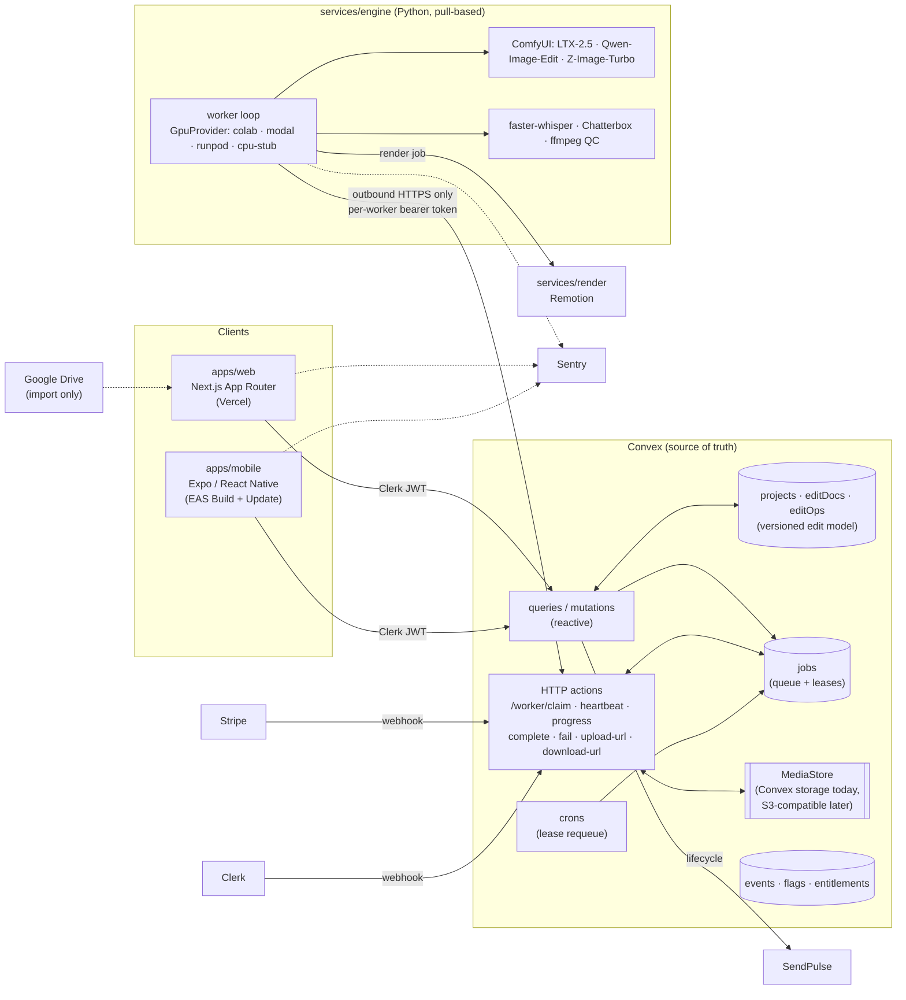

# Eyelore — plan

*Making real people look great.* Drop in raw clips, get back a polished, captioned, well-paced edit in about a minute.

Source of truth for scope: `docs/BUILD_PROMPT.md`. Product: `docs/product-notes.md`. Engine today: `docs/engine-assessment.md`. Decisions: `docs/adr/`.

Status legend: `[x]` done and verified · `[~]` built, waiting on keys or infra · `[ ]` not started.

---

## 1. Architecture



Principles that shape the code:
- **The edit model is the product.** Every change (user or autopilot) is an op on one versioned JSON document per project. AI never writes media directly into the UI; it proposes ops with a one-line reason.
- **The job contract is the only door to the GPU.** `packages/core/src/jobs.ts` (zod) → emitted JSON Schema → validated by the Python worker in CI.
- **Pull, never push.** Workers call out to Convex; no inbound ports. Same worker on Colab, Modal, RunPod or a laptop CPU stub.
- **Honest stubs.** A missing key or GPU gives a labelled stub that keeps the UI path working, listed in [Needs keys](#7-needs-keys).

## 2. Repo layout

```
apps/web            Next.js 15 App Router, Tailwind, Clerk, Convex client, Sentry
apps/mobile         Expo SDK (React Native), expo-router, NativeWind, Clerk Expo, Convex client
packages/ui         tokens (generated from design/tokens/*.css) → tailwind preset + RN tokens; shared primitives
packages/core       edit model, ops, domain types, zod schemas, analytics events, engine job contract, flags
convex/             schema, functions, http actions, crons (root-level so both apps share one deployment)
services/engine     Python worker (ported from legacy-engine/), GpuProvider, CPU stub, pytest
services/render     Remotion compositions for the final cut
design/             exported Claude Design system (read-only reference; tokens are the generator input)
brand/              logo vectors (exact; never redraw)
legacy-engine/      the Colab engine as found, reference only, never imported at runtime
```

## 3. Data model (Convex)

| table | purpose | key fields | indexes |
|---|---|---|---|
| `users` | Clerk-linked account | `clerkId`, `email`, `plan`, `createdAt` | `by_clerkId` |
| `sessions` | anonymous session before signup | `anonId` (random, client-held), `claimedBy?` | `by_anonId` |
| `projects` | one per edit | `ownerUserId?`, `ownerAnonId?`, `title`, `headVersion`, `aspect`, `genre?` | `by_owner_user`, `by_owner_anon` |
| `editDocs` | snapshot of the edit model at a version | `projectId`, `version`, `doc` (EditDoc JSON) | `by_project_version` |
| `editOps` | every change as a diff | `projectId`, `version`, `ops[]`, `reason`, `actor` (`user`/`autopilot:<name>`), `pins[]` | `by_project_version` |
| `media` | uploaded and generated assets | `projectId?`, `kind`, `storage` (`{provider, key}`), `proxyOf?`, `durationMs`, `w`, `h` | `by_project` |
| `jobs` | engine queue | `type`, `version`, `idempotencyKey`, `input`, `output?`, `status`, `progress`, `stage`, `attempts`, `maxAttempts`, `leaseOwner?`, `leaseExpiresAt?`, `projectId?`, `error?` | `by_status_created`, `by_idempotency`, `by_project`, `by_status_lease` |
| `workers` | registered GPU workers | `name`, `tokenHash` (SHA-256), `provider`, `capabilities[]`, `lastSeenAt`, `disabled` | `by_tokenHash` |
| `events` | funnel analytics | `name`, `anonId?`, `userId?`, `props`, `ts` | `by_name_ts`, `by_anon` |
| `flags` | feature flags | `key`, `enabled`, `rolloutPct`, `allow[]` | `by_key` |
| `entitlements` | server-checked plan limits | `userId`, `plan`, `minutesUsed`, `minutesLimit`, `credits`, `watermark` | `by_user` |
| `stripeEvents` | webhook idempotency | `eventId` | `by_eventId` |

**The edit model** (`packages/core/src/editModel.ts`, `schemaVersion: 1`):
```
EditDoc {
  schemaVersion, projectId, version,
  clips[]    { id, mediaId, source: "camera"|"upload"|"generated", w, h, durationMs, fps }
  beads[]    { id, clipId, inMs, outMs, words[]{ text, startMs, endMs, conf, struck? }, sentence, moment?: "hook"|"best"|"cta", struck?, pinned? }
  tracks     { video[], broll[], voice[], music[], captions[] }      // fixed order
  effects[]  { id, kind, anchor: {wordId}|{moment}|{ms}, params, reason }
  captions   { look, words-derived, overrides[] }
  style      { recipeId?, grade, pace, brollDensity, energy }
  genre?     RecipeRef
  aspect     "9:16"|"4:5"|"16:9"|"1:1"
  pins[]     paths the user touched — autopilots must not re-decide them
}
EditOp = { op: "set"|"insert"|"remove"|"move", path, value?, prev? }  // reversible
Change = { version, ops[], reason: "cut away · you said 'nightstand'", actor, at }
```
Undo = apply the inverse of the last change. Explain-on-hover = look up the most recent change touching that path. Pinning = any user change adds its paths to `pins`, and `applyAutopilot()` drops ops on pinned paths.

## 4. Engine job contract

Defined once in `packages/core/src/jobs.ts`, emitted to `packages/core/schema/jobs.schema.json`, validated by `services/engine` in CI.

- **Types:** `hello` (round-trip check), `transcribe`, `autocut`, `reframe`, `still`, `i2v`, `t2v`, `voice`, `matte`, `inpaint`, `grade`, `render`.
- **Envelope:** `{ id, type, version, idempotencyKey, input, attempt, leaseExpiresAt }`. Inputs and outputs are typed per job type. Media is referenced by `mediaId` and fetched via `download-url`, never by path.
- **Lifecycle:** `queued → leased → running → succeeded | failed`. A lease that expires without a heartbeat is requeued by a cron (`attempts < maxAttempts`) or failed.
- **HTTP (Convex `httpAction`, bearer worker token, SHA-256 compared):**

| route | body | returns |
|---|---|---|
| `POST /worker/claim` | `{ types[], leaseMs? }` | `{ job }` or `204` |
| `POST /worker/heartbeat` | `{ jobId }` | `{ leaseExpiresAt }` |
| `POST /worker/progress` | `{ jobId, progress 0..1, stage, previewMediaId? }` | `{ ok }` |
| `POST /worker/complete` | `{ jobId, output }` (validated against the type's output schema) | `{ ok }` |
| `POST /worker/fail` | `{ jobId, error, retryable }` | `{ ok }` |
| `POST /worker/upload-url` | `{ contentType }` | `{ uploadUrl }` → then `{ storageId }` registered by `complete` |
| `POST /worker/download-url` | `{ mediaId }` | `{ url }` |

- **Idempotency:** `enqueue` with an existing `idempotencyKey` returns the existing job. `complete` on a job not leased to the caller is rejected (stale lease).
- **GpuProvider** (Python): `cpu-stub` (deterministic fake outputs for CI), `colab`, `modal`, `runpod` — they differ only in how the process starts; the loop is identical.

## 5. Funnel

Typed events (`packages/core/src/analytics.ts`) → Convex `events` + Vercel Web Analytics.

```
landing_view → drop_started → upload_done → first_preview (time-to-wow) → edit_interaction
  → export_clicked → signup_prompted → signup_done → paywall_shown? → export_done → share
```
Primary metric: **time from `drop_started` to `first_preview`** (target ≤ 60 s) and **landing → export_done** conversion. Hero line A/B arm is carried on every event as `variant`.

## 6. Risks

| risk | impact | mitigation |
|---|---|---|
| GPU cold start (~10 min today, 70 GB of weights) | kills time-to-wow | CPU path for transcribe/autocut/captions (faster-whisper small runs on CPU); proxy preview first; persistent volumes on Modal/RunPod; honest "warming up · ~N min" status |
| Convex file storage limits for large video | cost and upload failure | `MediaStore` interface from day one; resumable chunked upload; S3-compatible swap in an ADR when needed |
| Identity/product drift in generated clips (assessment) | trust | Generation is Phase 3 and flagged; QC gate (reference similarity, motion score) before anything reaches the timeline |
| Meaning-changing edits | trust, brand | ops are restricted to cut/strike/reorder/polish; no word substitution except own-voice with consent; every change listed |
| Many external accounts not yet connected | can't prove CI exit criterion | stubs + "Needs keys" list; local anonymous Convex for development |
| Mobile e2e (Maestro on EAS) is slow/expensive | CI time | run on preview builds only when `apps/mobile` or `packages/*` change |

## 7. Needs keys

Integration is built behind a labelled stub until the key exists. Set them in Vercel, Convex, EAS and GitHub secrets — never in git.

| service | env vars | where | status |
|---|---|---|---|
| Convex | `CONVEX_DEPLOY_KEY` (CI), `NEXT_PUBLIC_CONVEX_URL`, `EXPO_PUBLIC_CONVEX_URL` | GitHub, Vercel, EAS | needs `npx convex login` + project |
| Vercel | `VERCEL_TOKEN`, `VERCEL_ORG_ID`, `VERCEL_PROJECT_ID` | GitHub | needs `vercel login` + project |
| Expo / EAS | `EXPO_TOKEN` | GitHub | needs `eas login` + project |
| Clerk | `NEXT_PUBLIC_CLERK_PUBLISHABLE_KEY`, `CLERK_SECRET_KEY`, `EXPO_PUBLIC_CLERK_PUBLISHABLE_KEY`, `CLERK_JWT_ISSUER_DOMAIN`, `CLERK_WEBHOOK_SECRET` | Vercel, Convex, EAS | stub: anonymous-only |
| Stripe | `STRIPE_SECRET_KEY`, `STRIPE_WEBHOOK_SECRET`, `NEXT_PUBLIC_STRIPE_PUBLISHABLE_KEY` | Convex, Vercel | stub: free tier only |
| SendPulse | `SENDPULSE_CLIENT_ID`, `SENDPULSE_CLIENT_SECRET` | Convex | stub: logs the email |
| Sentry | `SENTRY_DSN`, `NEXT_PUBLIC_SENTRY_DSN`, `EXPO_PUBLIC_SENTRY_DSN`, `SENTRY_AUTH_TOKEN` | all | stub: no-op |
| Worker | `EYELORE_WORKER_TOKEN`, `EYELORE_CONVEX_SITE_URL` | Colab/Modal/RunPod secrets | generated per worker by `convex run workers:register` |

## 8. Notes and conflicts found

- The design-system readme gives the tagline as "cringe in, cinema out". The brief overrides it: the tagline is **Making real people look great**; "From cringe to cinema" is a playful secondary line only.
- Design fonts (Geist, Geist Mono, Caveat) are self-hosted woff2 in the design project; the binaries don't export via the connector, so the apps load the same families from the `geist` npm package and `@fontsource/caveat`.

## 9. Milestones

### Phase 1 — foundation, CI/CD, harness
- [x] Inputs collected: product notes, engine assessment, brand marks, design system export, legacy engine
- [ ] PLAN.md (this file) and ADRs 0001–0008
- [ ] Monorepo: pnpm + Turborepo, TS strict, ESLint, Prettier
- [ ] `packages/core`: edit model + ops (apply/invert/pins), job contract, analytics events, flags; Vitest
- [ ] JSON Schema emitted from the contract; Python contract test reads it
- [ ] `packages/ui`: token generator (CSS → TS) → Tailwind preset + RN tokens; primitives (Lens, StatusDot, PillButton, Lockup)
- [ ] `convex/`: schema, jobs queue with leases, worker HTTP actions, lease-requeue cron, flags, events; convex-test
- [ ] `services/engine`: worker loop, GpuProvider, CPU stub, `hello` job; pytest; Dockerfile (CUDA)
- [ ] `services/render`: Remotion skeleton
- [ ] `apps/web`: landing + hello-job page with live progress; Playwright e2e
- [ ] `apps/mobile`: Expo shell with Convex + live job status; Maestro flow
- [ ] GitHub Actions: lint, typecheck, unit, convex tests, Playwright, pytest + contract, visual regression, Vercel/Convex/EAS previews, engine image to GHCR, release package
- [ ] `.env.example`, secret scanning
- [ ] **Exit:** PR goes green, previews deploy, hello job round-trips web → Convex → worker → live progress → result

### Phase 2 — the core loop *(not started)*
### Phase 3 — autopilots and AI editing *(not started)*
