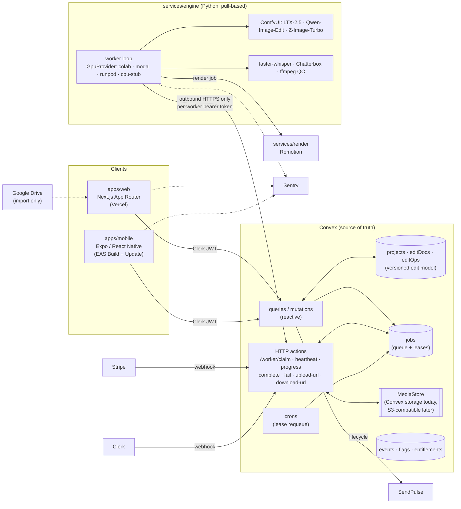

# Eyecandid — plan (formerly Eyelore; ADR 0011)

*Making real people look great.* Drop in raw clips, get back a polished, captioned, well-paced edit in about a minute.

Source of truth for scope: `docs/BUILD_PROMPT.md`. Product: `docs/product-notes.md`. Engine today: `docs/engine-assessment.md`. Decisions: `docs/adr/`.

Status legend: `[x]` done and verified · `[~]` built, waiting on keys or infra · `[ ]` not started.

---

## 1. Architecture



Principles that shape the code:
- **The edit model is the product.** Every change (user or autopilot) is an op on one versioned JSON document per project. AI never writes media directly into the UI; it proposes ops with a one-line reason.
- **The job contract is the only door to the GPU.** `packages/core/src/jobs.ts` (zod) → emitted JSON Schema → validated by the Python worker in CI.
- **Pull, never push.** Workers call out to Convex; no inbound ports. Same worker on Colab, Modal, RunPod or a laptop CPU stub.
- **Honest stubs.** A missing key or GPU gives a labelled stub that keeps the UI path working, listed in [Needs keys](#7-needs-keys).

## 2. Repo layout

```
apps/web            Next.js 15 App Router, Tailwind, Clerk, Convex client, Sentry
apps/mobile         Expo SDK (React Native), expo-router, NativeWind, Clerk Expo, Convex client
packages/ui         tokens (generated from design/tokens/*.css) → tailwind preset + RN tokens; shared primitives
packages/core       edit model, ops, domain types, zod schemas, analytics events, engine job contract, flags
convex/             schema, functions, http actions, crons (root-level so both apps share one deployment)
services/engine     Python worker (ported from legacy-engine/), GpuProvider, CPU stub, pytest
services/render     Remotion compositions for the final cut
design/             exported Claude Design system (read-only reference; tokens are the generator input)
brand/              logo vectors (exact; never redraw)
legacy-engine/      the Colab engine as found, reference only, never imported at runtime
```

## 3. Data model (Convex)

| table | purpose | key fields | indexes |
|---|---|---|---|
| `users` | Clerk-linked account | `clerkId`, `email`, `plan`, `createdAt` | `by_clerkId` |
| `sessions` | anonymous session before signup | `anonId` (random, client-held), `claimedBy?` | `by_anonId` |
| `projects` | one per edit | `ownerUserId?`, `ownerAnonId?`, `title`, `headVersion`, `aspect`, `genre?` | `by_owner_user`, `by_owner_anon` |
| `editDocs` | snapshot of the edit model at a version | `projectId`, `version`, `doc` (EditDoc JSON) | `by_project_version` |
| `editOps` | every change as a diff | `projectId`, `version`, `ops[]`, `reason`, `actor` (`user`/`autopilot:<name>`), `pins[]` | `by_project_version` |
| `media` | uploaded and generated assets | `projectId?`, `kind`, `storage` (`{provider, key}`), `proxyOf?`, `durationMs`, `w`, `h` | `by_project` |
| `jobs` | engine queue | `type`, `version`, `idempotencyKey`, `input`, `output?`, `status`, `progress`, `stage`, `attempts`, `maxAttempts`, `leaseOwner?`, `leaseExpiresAt?`, `projectId?`, `error?` | `by_status_created`, `by_idempotency`, `by_project`, `by_status_lease` |
| `workers` | registered GPU workers | `name`, `tokenHash` (SHA-256), `provider`, `capabilities[]`, `lastSeenAt`, `disabled` | `by_tokenHash` |
| `events` | funnel analytics | `name`, `anonId?`, `userId?`, `props`, `ts` | `by_name_ts`, `by_anon` |
| `flags` | feature flags | `key`, `enabled`, `rolloutPct`, `allow[]` | `by_key` |
| `entitlements` | server-checked plan limits | `userId`, `plan`, `minutesUsed`, `minutesLimit`, `credits`, `watermark` | `by_user` |
| `stripeEvents` | webhook idempotency | `eventId` | `by_eventId` |
| `accessRequests` | Pro "request access" from the landing (3 a day per email and per anon session) | `email`, `note`, `link`, `anonHash`, `createdAt`, `status` | `by_email_created`, `by_anon_created` |

**The edit model** (`packages/core/src/editModel.ts`, `schemaVersion: 1`):
```
EditDoc {
  schemaVersion, projectId, version,
  clips[]    { id, mediaId, source: "camera"|"upload"|"generated", w, h, durationMs, fps }
  beads[]    { id, clipId, inMs, outMs, words[]{ text, startMs, endMs, conf, struck? }, sentence, moment?: "hook"|"best"|"cta", struck?, pinned? }
  tracks     { video[], broll[], voice[], music[], captions[] }      // fixed order
  effects[]  { id, kind, anchor: {wordId}|{moment}|{ms}, params, reason }
  captions   { look, words-derived, overrides[] }
  style      { recipeId?, grade, pace, brollDensity, energy }
  genre?     RecipeRef
  aspect     "9:16"|"4:5"|"16:9"|"1:1"
  pins[]     paths the user touched — autopilots must not re-decide them
}
EditOp = { op: "set"|"insert"|"remove"|"move", path, value?, prev? }  // reversible
Change = { version, ops[], reason: "cut away · you said 'nightstand'", actor, at }
```
Undo = apply the inverse of the last change. Explain-on-hover = look up the most recent change touching that path. Pinning = any user change adds its paths to `pins`, and `applyAutopilot()` drops ops on pinned paths.

## 4. Engine job contract

Defined once in `packages/core/src/jobs.ts`, emitted to `packages/core/schema/jobs.schema.json`, validated by `services/engine` in CI.

- **Types:** `hello` (round-trip check), `transcribe`, `autocut`, `reframe`, `still`, `i2v`, `t2v`, `voice`, `matte`, `inpaint`, `grade`, `render`.
- **Envelope:** `{ id, type, version, idempotencyKey, input, attempt, leaseExpiresAt }`. Inputs and outputs are typed per job type. Media is referenced by `mediaId` and fetched via `download-url`, never by path.
- **Lifecycle:** `queued → leased → running → succeeded | failed`. A lease that expires without a heartbeat is requeued by a cron (`attempts < maxAttempts`) or failed.
- **HTTP (Convex `httpAction`, bearer worker token, SHA-256 compared):**

| route | body | returns |
|---|---|---|
| `POST /worker/claim` | `{ types[], leaseMs? }` | `{ job }` or `204` |
| `POST /worker/heartbeat` | `{ jobId }` | `{ leaseExpiresAt }` |
| `POST /worker/progress` | `{ jobId, progress 0..1, stage, previewMediaId? }` | `{ ok }` |
| `POST /worker/complete` | `{ jobId, output }` (validated against the type's output schema) | `{ ok }` |
| `POST /worker/fail` | `{ jobId, error, retryable }` | `{ ok }` |
| `POST /worker/upload-url` | `{ contentType }` | `{ uploadUrl }` → then `{ storageId }` registered by `complete` |
| `POST /worker/download-url` | `{ mediaId }` | `{ url }` |

- **Idempotency:** `enqueue` with an existing `idempotencyKey` returns the existing job. `complete` on a job not leased to the caller is rejected (stale lease).
- **GpuProvider** (Python): `cpu-stub` (deterministic fake outputs for CI), `colab`, `modal`, `runpod` — they differ only in how the process starts; the loop is identical.

## 5. Funnel

Typed events (`packages/core/src/analytics.ts`) → Convex `events` + Vercel Web Analytics.

```
landing_view → drop_started → upload_done → first_preview (time-to-wow) → edit_interaction
  → export_clicked → signup_prompted → signup_done → paywall_shown? → export_done → share
```
Primary metric: **time from `drop_started` to `first_preview`** (target ≤ 60 s) and **landing → export_done** conversion. Hero line A/B arm is carried on every event as `variant`.

## 6. Risks

| risk | impact | mitigation |
|---|---|---|
| GPU cold start (~10 min today, 70 GB of weights) | kills time-to-wow | CPU path for transcribe/autocut/captions (faster-whisper small runs on CPU); proxy preview first; persistent volumes on Modal/RunPod; honest "warming up · ~N min" status |
| Convex file storage limits for large video | cost and upload failure | `MediaStore` interface from day one; resumable chunked upload; S3-compatible swap in an ADR when needed |
| Identity/product drift in generated clips (assessment) | trust | Generation is Phase 3 and flagged; QC gate (reference similarity, motion score) before anything reaches the timeline |
| Meaning-changing edits | trust, brand | ops are restricted to cut/strike/reorder/polish; no word substitution except own-voice with consent; every change listed |
| Engine cost and availability | two always-warm Modal containers spent the workspace budget in hours and the engine stopped | workers scale to zero and Convex wakes one when a job waits (ADR 0010); the first clip after a quiet spell pays a cold start (to be measured on production); a spend cap can still stop the engine, so set a budget alert |
| OpenCV 5 dropped the Haar face detector | reframe pinned to OpenCV 4 | move to YuNet (`cv2.FaceDetectorYN`) with a vendored model |
| Many external accounts not yet connected | can't prove CI exit criterion | stubs + "Needs keys" list; local anonymous Convex for development |
| EAS cloud builds are slow for a per-PR check (free tier: ~17 min in the queue, then 14–26 min to build) | the mobile e2e outlived its pushes and never finished | the APK is built on the CI runner (x86_64 release, cached on the app's inputs) and Maestro runs against a local Convex + CPU worker; runs only when mobile-relevant paths change. EAS cloud builds work and are for real-device previews and store submission: `eas build --profile preview` |

## 7. Needs keys

Integration is built behind a labelled stub until the key exists. Set them in Vercel, Convex, EAS and GitHub secrets — never in git.

| service | env vars | where | status |
|---|---|---|---|
| Convex | `CONVEX_DEPLOY_KEY` (prod), `CONVEX_PREVIEW_DEPLOY_KEY` | GitHub | project `SQco/eyelore` created (dev `deafening-hedgehog-824`, prod `hushed-heron-814`); **deploy keys needed** |
| Vercel | `VERCEL_TOKEN` (`VERCEL_ORG_ID`, `VERCEL_PROJECT_ID` set) | GitHub | project `everstock/eyelore` created, root `apps/web`, no git link (CI deploys); **token needed** |
| Expo / EAS | `EXPO_TOKEN` (`EXPO_PUBLIC_CONVEX_URL[_PREVIEW]` set) | GitHub | project `@devluca999/eyelore` linked; `EXPO_TOKEN` is only used for EAS Update on main. PR CI no longer needs it |
| Clerk | `NEXT_PUBLIC_CLERK_PUBLISHABLE_KEY`, `CLERK_SECRET_KEY`, `EXPO_PUBLIC_CLERK_PUBLISHABLE_KEY`, `CLERK_JWT_ISSUER_DOMAIN`, `CLERK_WEBHOOK_SECRET` | Vercel, Convex, EAS | web: provider wired, switches on with the publishable key; Convex `auth.config.ts` is an empty-provider stub (anonymous-only); mobile Clerk and the anon→account claim are **not built yet** (Phase 2) |
| Stripe | `STRIPE_SECRET_KEY`, `STRIPE_WEBHOOK_SECRET`, `NEXT_PUBLIC_STRIPE_PUBLISHABLE_KEY` | Convex, Vercel | **not built yet** (Phase 2: paywall at export, webhooks into Convex, server-side entitlements) |
| SendPulse | `SENDPULSE_CLIENT_ID`, `SENDPULSE_CLIENT_SECRET` | Convex | **not built yet** (Phase 2: "your edit is ready") |
| Sentry | `SENTRY_DSN`, `NEXT_PUBLIC_SENTRY_DSN`, `EXPO_PUBLIC_SENTRY_DSN`, `SENTRY_AUTH_TOKEN` | all | **not built yet**: `@sentry/nextjs` installed, no init; mobile and worker not instrumented |
| Engine wake | `EYELORE_WAKE_URL` | Convex | built (`convex/wake.ts`, Modal `wake` endpoint); **not deployed**: needs the Modal spend cap raised, a redeploy, and the printed URL set on each Convex deployment |
| Pro access (Phase 4) | `EYELORE_ADMIN_TOKEN`, `EYELORE_PRO_SEATS` (default 100), `EYELORE_WEB_URL`; reuses `SENDPULSE_*`, `STRIPE_SECRET_KEY`, `STRIPE_PRICE_CREATOR`, `STRIPE_WEBHOOK_SECRET` | Convex | built: `/admin/access` (says "not configured" without the admin token), approve → `pro` allow list + "you're in" email (row reads "not sent · SendPulse not configured" without SendPulse; **resend** once it is) → `/pro/checkout` (says "billing isn't switched on yet" until `STRIPE_SECRET_KEY` + the `billing` flag). Pro is sold as the `creator` price. GPU jobs are refused without an approved, paid, credited owner. **Needs:** the keys above, `billing` flag on, Stripe webhook registered |
| Worker | `EYELORE_WORKER_TOKEN`, `EYELORE_CONVEX_SITE_URL` | Colab/Modal/RunPod secrets | generated per worker by `convex run workers:register`; CI's dev worker token is in GitHub secrets as `EYELORE_DEV_WORKER_TOKEN` |

## 8. Notes and conflicts found

- The design-system readme gives the tagline as "cringe in, cinema out". The brief overrides it: the tagline is **Making real people look great**; "From cringe to cinema" is a playful secondary line only.
- Design fonts (Geist, Geist Mono, Caveat) are self-hosted woff2 in the design project; the binaries don't export via the connector, so the apps load the same families from the `geist` npm package and `@fontsource/caveat`.
- **Verify:** `brand/` holds your 3 marks untouched. The 4 extra files (`eyelore-mark-small-inverse.svg`, `favicon.svg`, `eyelore-app-icon-paper.svg`, `eyelore-app-icon-night.svg`) came from the design project; the connector stamps SVGs with provenance metadata, so the export agent reassembled them from the small mark and matched the listed byte sizes exactly. Same artwork by size and path data, but please re-export these four from Claude Design to be certain.
- Visual-regression baselines (Linux, from CI) are committed in `apps/web/e2e/landing.spec.ts-snapshots/`; local macOS baselines are ignored. Regenerate with `--update-snapshots` in CI when a screen changes on purpose.

## 9. Milestones

### Phase 1 — foundation, CI/CD, harness
- [x] Inputs collected: product notes, engine assessment, brand marks, design system export, legacy engine
- [x] PLAN.md (this file) and ADRs 0001–0008
- [x] Monorepo: pnpm + Turborepo, TS strict, ESLint, Prettier — repo `devluca999/eyelore` (private)
- [x] `packages/core`: edit model + ops (apply/invert/pins), job contract, analytics events, flags — 12 tests
- [x] JSON Schema emitted from the contract; Python contract test reads it; CI fails on drift
- [x] `packages/ui`: token generator (design CSS → Tailwind v4 theme + RN tokens + component CSS + icons); web primitives Lens, Footage, StatusDot, PillButton, Lockup, Icon; AA contrast test
- [x] `convex/`: schema, jobs queue with leases, worker HTTP actions, lease-requeue cron, flags, events, MediaStore — 9 tests
- [x] `services/engine`: worker loop, GpuProvider, CPU stub, `hello` + `autocut` + `transcribe` handlers, ffmpeg QC port; Dockerfile (CUDA) — 9 tests
- [x] `services/render`: Remotion `Cut` composition from the edit model; tested timeline (struck words skipped, captions verbatim)
- [x] `apps/web`: landing (A/B hero line, funnel event) + `/hello` with live progress and honest cold-GPU status; Playwright e2e + visual
- [x] `apps/mobile`: Expo shell (expo-router, Convex, haptics, keychain anon id) + live hello; Maestro flow; iOS bundle builds
- [~] GitHub Actions: checks, convex, engine, e2e + visual run keyless; Vercel/Convex/EAS previews, production deploy and EAS Update wired but **need keys**; GHCR image + release package on main/tags
- [x] `.env.example`, gitleaks in CI
- [~] **Exit:** PR #1 is green on every keyless check, and the hello job round-trips web → Convex → worker → live progress → result in CI. Web and mobile previews (and Maestro on the EAS build) wait on keys.

### Phase 2 — the core loop *(in progress)*

Where work runs (decided 2026-11-16): one worker codebase behind `GpuProvider`. Transcription, autocut, reframe and render run on **CPU** (`EYELORE_PROVIDER=cpu`: faster-whisper, OpenCV, Remotion + ffmpeg); GPU jobs (generation, Phase 3) on serverless GPU (Modal / RunPod) from the same CUDA image. Production needs an always-on CPU worker host — **open decision**, see Risks.

**2.1 Pipeline** — branch `phase-2/pipeline`
- [x] Edit model: silence cuts (restorable), reframe face tracks; contract: render takes a doc snapshot, reframe returns a face track
- [x] `packages/core/pipeline.ts`: engine outputs → explained changes (beads at sentences, one change per strike, hook / best line / CTA), cutdowns that keep hook and CTA
- [x] Convex: projects (anonymous), upload + source registration, proxy registration, live `projects.get`, edit API with optimistic versions + undo + history, pipeline orchestration on job completion, export with server-side watermark/cap
- [x] Engine: real `transcribe` (faster-whisper, CPU int8), `reframe` (OpenCV face track, smoothed), `render` (Remotion cut → high-pass + denoise + loudnorm −14 LUFS → QC)
- [x] Renderer: silences dropped, face-centred cover crop for any aspect, watermark
- [x] Live run on the dev deployment (CPU worker on a laptop, 9s clip): **ready 7.8s after the drop** (upload 1.6s, transcribe ~5.5s warm, autocut <1s); reframe +6s; 9:16 export 1080×1920 captioned and watermarked. Render is slow on CPU (~65s for 7s of output): first target for 2.2
- [~] Engine image with Node + renderer: Dockerfile updated, built by CI on PRs (no push)
**Launch (2026-11-17, docs/mvp-spec.md):** merged #14 #13 #10 #7 #12 #15 #16 #18 #19 #17. Rename to Eyecandid live (ADR 0011); landing v2 live (mobile LCP 3.8 s simulated — see HANDOFF 1b); on-device engine spike at /lab/local. Blocked: Modal cap (no worker on prod), eyecandid.co not bought.

**2.2a Web core loop** — branch `phase-2/web-loop`
- [x] Drop zone on the landing (drag anywhere or "choose a clip"); no signup; editor opens at once on the local file while it uploads (XHR progress, 3 retries)
- [x] Live pipeline in the Lens: shimmer + an honest stage line (uploading %, listening, trimming, cold engine, failures with the reason)
- [x] Player previews the edit from the raw source, skipping struck words/pauses/beads exactly as the render does (shared `toTimeline`)
- [x] Bead thread on real beads: stills per bead, words above (struck faint, click to restore; click any word to cut), pauses as "· 1.4s", moment ticks; select a bead to keep/cut it
- [x] Captions on the footage, verbatim; click a word to fix spelling (server rejects anything that changes the word)
- [x] Explain-on-hover from the change log; summary line ("4 fillers trimmed · 1 pause cut")
- [x] Right-click Lens: aspect morph (face-centred crop), true aspect, moments only, export cutdowns; ⌘Z undo, space play, delete cuts a bead
- [x] Export pill: ratio + 15/30/60 cutdowns, ring on the Lens edge, download
- [x] Funnel events: drop_started, upload_done, first_preview (time-to-wow), edit_interaction, export_clicked, export_done
- [x] Playwright: landing → exported 9:16 in **55–62s** locally (real CPU worker), CI runs it with a real worker
- [x] Delete an edit for good (owner only): project, edit doc and change log, exports, jobs and every stored file through `MediaStore.delete`; a job running at that moment is canceled and anything it uploads late is removed. Web: quiet "delete" in the editor with an in-app confirm, and a "your edits" list on the landing to find it again. Mobile control ships with 2.3 — 6 convex tests, 1 Playwright
- [ ] Resumable upload (chunked storage behind MediaStore) and an uploaded proxy for other devices
**2.2b Web, rest** — branch `phase-2/web-rest` (PR #9)
- [~] One Lens across theater (Night, circle, plays the edit, progress ring) / edit / board (a card per bead: still, sentence, moment tick, struck, keep/cut); spring morph; keys 1/2/3
- [~] Dials re-edit live: `packages/core/src/dials.ts` `dialChanges` (pace strikes/restores pauses on a 1.2s → 0.45s → 0.25s line, 0.5 = autocut; energy punch-ins 1.04–1.12× on hook, best line, call to action, then more beads; b-roll density stored, decides nothing until Weave), `autopilot:dials`, one-line reasons, pins respected, exact round trip; `edits.setDials`; ⌘Z follows
- [~] Energy punch-ins in the export (Remotion, the same `punchAt` as the preview); no job-contract change
- [~] Timeline drawer (⌥T or the handle), five tracks in `TRACK_ORDER` on real data; b-roll and music honestly empty
- [~] "?" shortcut sheet and a 4-step skippable first-run tour
- [ ] Punch-ins in the mobile preview (the export has them)
**2.3 Mobile** — branch `phase-2/mobile` (native screens, no webview)
- [x] Home: record or import, no signup; recent edits (`projects.mine`)
- [x] Capture with a teleprompter: script one line per row, one continuous recording, the current line under the lens, tap for the next; a line said twice keeps the last take (`retakeChanges`, restorable). Not exercised on a device yet: simulators have no camera
- [x] Camera-roll import through the system picker (original file, no re-encode); upload with real progress and three tries. iOS starts a background `URLSession` and falls back to an in-app upload if it has not sent a byte in 8s (the simulator never starts one); Android uploads in-process
- [x] Review in the theater: Night, circle Lens, plays the edit from the source skipping struck words, pauses and lines (shared `toTimeline`); captions on the footage; the Lens morphs to the frame at the chosen ratio, face-centred (`coverBox`)
- [x] Light edits: tap a word or pause to cut/restore, cut/keep a line, hold a word to fix its caption spelling (server rejects meaning changes), aspect, undo
- [x] Export → saved to the camera roll, then the share sheet; funnel events with `platform`
- [x] Haptics on every action and result; VoiceOver/TalkBack labels, hints, states and live regions; 44pt targets on controls
- [x] iOS simulator, local Convex backend + real CPU worker: clip → ready → exported 1080×1920 h264 in the camera roll in under 60s (started through the dev-only clip route: no touch automation on this machine)
- [x] Maestro `core-loop.yaml` on the Android emulator in CI (local Convex + real CPU worker, 2-core runner): import through the real photo picker → ready → restore a word → export → saved, in **138s** and **151s** on two runs, with a 1080×1920 export in the gallery; `delete.yaml` then removes the edit. CI fails the job if the core loop takes 180s or more (a slow runner once took 211s with the earlier, slower flow)
- [ ] Geist fonts in the native app (system font today); Clerk and the paywall on mobile (needs keys and an in-app-purchase decision); Android foreground service for long uploads; Sentry
**2.4 Around the loop**
- [~] Accounts with the anonymous work claimed on signup, server-side entitlements, paywall at export, "your edit is ready" email, Sentry on web and worker: built as stubs until keys (PR #7, ADR 0009). Flags `accounts`, `billing`, `ready_email`, default off. Paywall rules apply only with the `billing` flag and a Stripe key
- [~] Funnel dashboard at `/funnel`, gated by `EYELORE_ADMIN_TOKEN` (PR #10)
- [x] Delete an edit for good, web and mobile (#6): project, history, exports, jobs and stored files; Maestro and Playwright cover it
- [ ] Idea engine empty state (needs an LLM provider and key)
- [ ] Owner decisions: plan names, prices and limits, soft or hard signup gate, deletion policy on account removal
- [ ] Run sign-up and checkout end to end once keys exist; Clerk and the paywall on mobile
**Landing v2 (Eyecandid)** — branch `feat/landing-v2`, from `design/landing-v2`
- [x] Tokens generated from `design/system-v2` (v1 names the editor still reads live in `packages/ui/scripts/compat.css`)
- [x] Landing sections in the design's order on the real uploader; self-hosted Mixkit loops (`scripts/media`, `docs/credits.md`, `/credits`); reduced motion = posters, no pinning
- [x] Pricing Free / Pro with request access → `accessRequests` (no prices); founder letter and proof are labelled placeholders on previews, hidden in production
- [ ] Founder letter (Luca to write); proof strip after launch, with consent; admin page for access requests (mvp-spec Phase 4); Lockup wordmark → eyecandid (separate PR)
### Phase 3 — autopilots and AI editing *(not started)*
